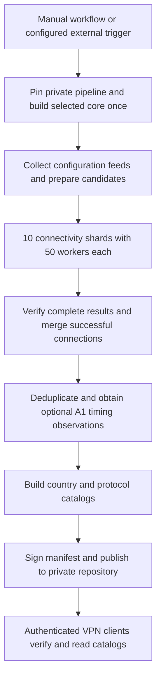

# VPN-Nodes

VPN-Nodes is the public workflow and documentation repository for a VPN software project's node-catalog pipeline. The pipeline collects configuration feeds, checks connections with the project's VPN core, and produces signed catalogs for the owner's Android and Windows clients.

**The connectivity stage makes real network connections through third-party proxy nodes and sends HTTPS requests to third-party validation services.** The following sections describe those activities, their resource settings, the publication process, and the boundary between public documentation and private data.

## Repositories and current deployment status

| Repository | Visibility | Role |
| --- | --- | --- |
| [VPN-Nodes](https://github.com/ADNM0/VPN-Nodes) | Public | Workflow launchers, recovery-context verification, and project documentation. |
| [VPN-Nodes-Private](https://github.com/ADNM0/VPN-Nodes-Private) | Private | Collectors, pipeline implementation, source inventory, diagnostics, and signed catalog output. |
| [VPN-Core](https://github.com/ADNM0/VPN-Core) | Private | VPN protocol implementation and the production `nodecheck` command used by the pipeline. |

As of 2026-11-11, repository Actions are disabled and no catalog workflow has been started on this account. The nine required runtime secrets have been configured on this runner repository, including dedicated private-repository read/write deploy keys. The preserved catalog signing key matches the public keys in both catalog repositories, and the owner-supplied Core read token has been verified against this account's private Core repository. Secret values remain outside Git. Imported workflow and implementation references still require migration to this account before execution; the external scheduler and installed applications have not been migrated. The settings below describe the checked-in pipeline configuration, rather than evidence of a completed run on this account.

The private inventory currently contains 1,106 source entries. This is a versioned inventory size, not a fixed limit on sources, files, countries, or nodes.

## Processing flow

### 1. Read configuration sources

The source inventory is maintained by the owner. Collectors fetch the configured feeds and supported directory sources; additional adapters handle their existing source formats. Inputs include share links, Base64 subscriptions, JSON, JSONL, YAML, and CSV where supported by the corresponding reader. Directory sources discover their current files instead of requiring a permanently fixed filename. A directory's 36-hour freshness selection applies where that option is explicitly configured.

Collection retains the original connection URIs and their connection settings. The established collection port policy is 443. Separate desktop tools handle source-list maintenance; the catalog workflow does not automatically rewrite the source inventory to discover replacement sources.

Each collector records its own result directly: `ok`, `failed`, `empty`, or `partial`, along with supported-node counts and available request diagnostics. An empty source means that no supported nodes were extracted; it is a different outcome from a failed download. An interrupted collection is marked incomplete.

### 2. Prepare candidates and verify the core

Shared TCP host/port checks avoid repeating the same preliminary endpoint check. Explicit UDP transports use the existing path that bypasses this TCP gate. A successful TCP connection alone does not qualify a node for publication.

The workflow resolves the selected core revision once, builds it once, and records the source revision and binary SHA-256. Candidate preparation and all checker shards use that same build and input snapshot. The pipeline verifies these identities when consuming results.

### 3. Check actual protocol connections

The checker supports the project's four remote proxy protocols: **VLESS, VMess, Trojan, and Shadowsocks**, including supported Shadowsocks variants. The core parses each original URI and uses its protocol and transport implementation to attempt the connection.

Candidates are grouped by protocol and assigned by their position modulo the shard count. Every candidate belongs to one connectivity shard. A run must provide the expected complete set of shard results; missing, duplicate, foreign, or incomplete results stop publication instead of silently reducing coverage.

| Connectivity setting | Configured value |
| --- | --- |
| Checker shards | 10, numbered 0 through 9 |
| Maximum parallel checker jobs | 10 |
| Node-check workers per shard | 50 |
| Aggregate node-check worker budget | **500 = 10 × 50** |
| Per-node deadline | 6 seconds |
| Per-target attempt deadline | 2 seconds |
| Metadata timeout | 4 seconds |

The 500 figure is the aggregate logical worker budget for this stage. It is not a node-count limit, a reservation of 500 GitHub runners, or an allowance for 500 simultaneous GitHub API requests. Actual job availability depends on GitHub's runner availability and account limits. Source collection has separate settings: 32 source workers, 16 GitHub-source workers, and 4 workers per source host. Those settings are unchanged by the connectivity-shard configuration.

Through the selected node, the core uses the configured HTTPS validation targets:

- Google `gstatic.com/generate_204`.
- Microsoft `microsoft.com/robots.txt`.
- Cloudflare `cloudflare.com/cdn-cgi/trace`.
- `example.com`.
- Apple `apple.com/library/test/success.html`.

Connectivity evidence includes a TLS-verified final HTTP response with status 200–599 from a configured target, together with the core's successful connection result. An HTTP error status can therefore demonstrate an established HTTPS connection; this is a connectivity observation, rather than a statement that the destination application returned successful content.

### 4. Resolve countries and rank successful nodes

After connectivity succeeds, bounded metadata requests obtain exit information through the node. The existing process uses an exit-IP service, an owner-configured country service, and GeoLite2/host lookup fallbacks. Metadata failure retains a proven connection and can leave its country as `XX`.

Successful results are merged and deduplicated using the existing connection identity rules. The original share URI remains attached to the retained connection.

The publication path also contains a separate A1-hosted timing stage after successful-node deduplication. It sends bounded HTTPS timing probes through successful nodes and records measured or unmeasured observations. It requires separately configured SSH access to the owner's server. Ranking failures do not remove nodes that already passed connectivity checks. The 500-worker connectivity budget does not change this stage's independent policy. Server addresses, credentials, and access material are kept out of this public description.

### 5. Sign and publish catalogs

The finalizer builds country and protocol feeds, matching country shards, and metadata. Country and file counts are determined by the verified results. A manifest records file hashes and is signed with the owner's ECDSA P-256 catalog key. Clients verify the signature and matching file hashes before accepting the catalog.

Publication writes generated output to the private repository. The publisher fetches the current branch and overlays the intended generated payload using an explicit Git lease, preserving unrelated changes and refusing stale replacement of newer output. The current public repository is not the application's authenticated catalog download location.

## Triggers, job limits, and recovery

The catalog workflow has a `workflow_dispatch` trigger. An external scheduler can call that trigger after it is separately configured; no external scheduler was activated by this repository upload. The catalog workflow itself has no native cron schedule. Its concurrency group queues overlapping updates instead of cancelling an active run.

The imported GeoLite2 maintenance workflow has manual dispatch and a separate Tuesday/Friday `04:17 UTC` schedule. It updates the country database in the private repository when Actions and its required access have been configured.

Configured job timeouts are 20 minutes for the core build, 60 minutes for collection, 45 minutes per connectivity shard, 45 minutes for publication, and 10 minutes for GeoLite2 maintenance. These are job deadlines; they do not guarantee completion or override platform quotas.

For a fresh catalog, the owner leaves `publish_run_id` empty and selects `core_ref`, which defaults to `main`. Publication-only recovery uses a completed source-run ID, validates its provenance and saved artifacts, and reuses those results. Recovery checks the publication/signing contract and refuses missing required evidence or incompatible inputs.

## Public information and protected data

The current public workflow files reference GitHub secret names, while secret values are supplied only at runtime. Required access covers private-repository reads/writes, the core read credential, artifact-encryption keys, the catalog signing key, the country-service configuration, and A1 SSH access. Values are provisioned separately from source control.

Intermediate candidate, checker, and diagnostic artifacts are encrypted using AES-256-GCM and bound to the repository, source run, and artifact kind. Public logs show aggregate progress and counts. Per-source URLs and outcomes, node connection material, detailed failures, and private service responses belong in the private pipeline or encrypted diagnostics. The encrypted collector diagnostics include the structured `source-status.json` report. Checker artifacts have a seven-day retention setting.

Application users supply their own read credential through the application's settings. Catalog signing and encryption credentials are separate from that read credential. Public signing keys and file hashes are verification material; private signing keys, tokens, SSH keys, and decryption-key values must remain outside public documentation and Git.

## Service use and operational review

This documentation describes real collection, proxy connectivity checks, third-party HTTPS requests, optional external-server timing, and catalog publication. The operator must ensure that use of the feeds, proxy nodes, destination services, and hosting resources is permitted and observe applicable rate limits.

GitHub's [additional product terms for Actions](https://docs.github.com/en/site-policy/github-terms/github-terms-for-additional-products-and-features#actions) govern execution, including workload relevance and disproportionate resource use. Documentation and a lower shard count do not establish approval for a workload or guarantee account availability. Actions remain disabled in this account until the owner separately configures and activates execution. This upload has not run node checks, produced a new catalog, or measured production performance.
